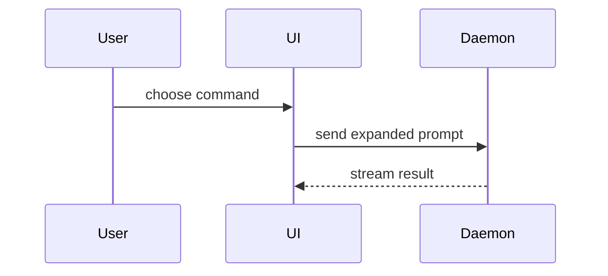

## Reader and language

The reader is a human reviewer. They did not see the design discussion, the spec, or your session. Write so that they understand the change from the PR alone.

- Write prose in ASD-STE100: one topic per sentence, at most 20 words for a procedure and 25 for a description, active voice, plain approved words. Write "for example", not "e.g.".
- Skip preambles. Use the user's domain language from `GLOSSARY.md`.
- Use only references the reviewer can open: issue links, PR numbers, files in the repo. A short spec section reference (for example §4.6) is fine when the team process uses it. Spec decision ids, local paths outside the repo, and session notes stay out.
- Put the content in this order:
  1. The problem, in one or two sentences.
  2. What changes: one small visual per change, next to its text (see [Summary](#summary)).
  3. Why, only for the parts that are not obvious.
  4. What the reviewer must decide or know.

  The body ends after item 4, with no tests or test plan section.

Use this template for writing the PR body:

```markdown
## Summary

<diagram, diff-sketch, or tree>
```

## Sections

### Summary

Pick the smallest view that makes the key point clear.

- Show logic or an algorithm as pseudocode:

```text
on(save)
  if content is unchanged
    return cached result
  write new content
  return fresh result
```

- Show runtime control flow as a call tree:

```text
submitForm
  createSession
    persistPrompt
    launchAgent
  navigateToSession
```

- Show UI structure as a component tree, including state and module boundaries that matter:

```text
<SessionPage> (apps/example/src/routes/session.tsx)
  useSessionEvents()
  <SessionToolbar>
    <RunSkillButton> (packages/ui)
```

- Show file responsibility or a broad refactor as a shallow file tree:

```text
src/
├── commands/       # parses user actions
├── sessions/       # owns session state
└── transport/      # sends API requests
```

- Show component interaction, control flow, or data flow with Mermaid:



- Use `diff` when the point is what changes and the surrounding shape already exists. Match the diff shape to the topic.

For a component change:

```diff
 <SessionPage>
   useSessionEvents()
   <SessionToolbar>
+    <RunSkillButton />
   <SessionTimeline>
+    <SkillResultCard />
```

For a file-layout change:

```diff
 src/
 ├── commands/
+│   └── show-me.ts       # expands the slash command
 ├── sessions/
-└── transport.ts
+└── transport/
+    ├── client.ts
+    └── stream.ts
```

For a call-tree or call-stack change:

```diff
 submitForm
   createSession
     persistPrompt
+    expandSkillMention
     launchAgent
-  navigateToSession
+  navigateToSession
+    subscribeToEvents
```

For a state or control-flow change:

```diff
 on(save)
-  write content
+  if content is unchanged
+    return cached result
+  write new content
+  invalidate cache
```

- Show the whole block when most of it is new, when omitted context would hide ownership or order, or when the user needs a copyable target shape:

```ts
function expandSkill(command: string): string {
  const skillName = command.slice(1);
  return `use the ${skillName} skill`;
}
```

#### Guidance

Place each visual next to the short text it supports. Keep only the calls, files, props, states, and boundaries needed to answer the user's current question or the options to resolve the current discussion point.

You may use one of these, you may use several, it is unlikely you will use all of them. Use your judgement and don't overwhelm the user.
